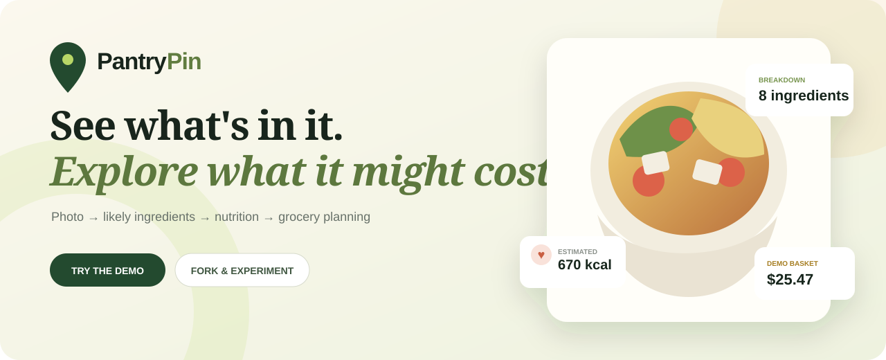
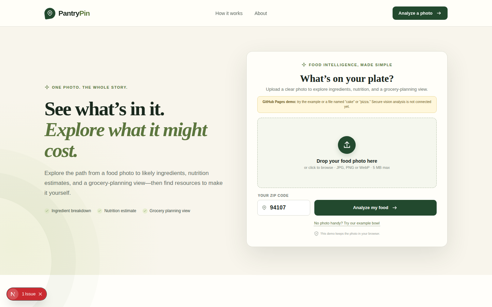
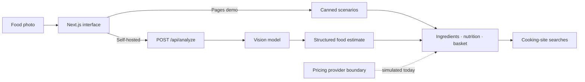

<p align="center">
  
</p>

<h1 align="center">PantryPin</h1>

<p align="center">
  <strong>From a food photo to likely ingredients, estimated nutrition, and a grocery-planning view.</strong>
</p>

<p align="center">
  <a href="https://nahin333.github.io/where-and-how-much/"><strong>Try the simulated demo →</strong></a>
  &nbsp;·&nbsp;
  <a href="https://github.com/nahin333/where-and-how-much/releases">Releases</a>
  &nbsp;·&nbsp;
  <a href="./CONTRIBUTING.md">Contribute</a>
</p>

<p align="center">
  <a href="https://github.com/nahin333/where-and-how-much/actions/workflows/ci.yml"></a>
  <a href="https://github.com/nahin333/where-and-how-much/actions/workflows/deploy-pages.yml"></a>
  <a href="https://github.com/nahin333/where-and-how-much/releases"></a>
  <a href="https://github.com/nahin333/where-and-how-much"></a>
</p>

<p align="center">
  
</p>

> [!IMPORTANT]
> PantryPin is an experimental MVP. The public GitHub Pages experience uses canned food scenarios selected by filename and simulated store data—it does **not** inspect image pixels. Self-hosting with an OpenAI API key enables actual image analysis. Live retailer pricing and inventory are not implemented yet.

## Why PantryPin?

Food photos are rich in inspiration but poor in practical detail. PantryPin explores one continuous workflow:

1. **See it** — start with a meal, snack, dessert, fruit, or drink photo.
2. **Understand it** — turn the dish into likely ingredients, a calorie range, macros, and confidence signals.
3. **Recreate it** — compare an illustrative ingredient basket and open relevant searches on established cooking sites.

The aim is not false precision. A single photo cannot reveal exact portions, hidden oils, or every ingredient, so uncertainty is treated as part of the interface—not hidden in fine print.

## What works today

| Capability | GitHub Pages demo | Self-hosted with API key |
| --- | --- | --- |
| Photo content analyzed | No—canned scenario selected by filename | Yes—vision model analyzes the image |
| Dish, ingredients, and nutrition | Sample output | Model estimates with confidence levels |
| Store prices, locations, and pickup times | Simulated | Simulated; retailer API not connected |
| Recipe resources | Generated search links | Generated search links |
| Photo persistence by PantryPin | None | None; the image is sent to your configured model provider |

Try a file containing **cake** or **pizza** in its filename to switch scenarios in the Pages demo; other names show the grain-bowl scenario.

## Features

- Drag-and-drop food photo upload with validation and preview
- Structured dish and ingredient breakdowns
- Calorie ranges and macro estimates instead of a misleading single truth
- Per-ingredient confidence labels and uncertainty notes
- Deterministic ZIP-sensitive demo baskets for Walmart, ALDI, and Target
- Responsive comparison views for ingredients, stores, and recipe searches
- Optional OpenAI Responses API integration using image input and a strict JSON schema
- Static GitHub Pages deployment plus a separable server API
- Accessible keyboard controls and reduced-motion support

## Quick start

Requires Node.js 20.9 or newer.

```bash
git clone https://github.com/nahin333/where-and-how-much.git
cd where-and-how-much
npm install
cp .env.example .env.local
npm run dev
```

Open `http://localhost:3000`.

Without an API key, the local server returns labeled demo data. To enable real image analysis:

```bash
# .env.local
OPENAI_API_KEY=your_key_here
OPENAI_VISION_MODEL=gpt-4o-mini
```

Never prefix the secret with `NEXT_PUBLIC_` or commit `.env.local`.

## Configuration

| Variable | Where | Purpose |
| --- | --- | --- |
| `OPENAI_API_KEY` | Server only | Enables vision analysis |
| `OPENAI_VISION_MODEL` | Server only | Chooses the vision-capable model |
| `ALLOWED_ORIGIN` | External API server | Restricts cross-origin frontend requests |
| `NEXT_PUBLIC_API_BASE_URL` | Frontend build | Points Pages to a separately hosted API |
| `NEXT_PUBLIC_STATIC_DEMO` | Frontend build | Enables browser-only scenario mode |
| `NEXT_PUBLIC_BASE_PATH` | Pages build | Sets the repository subpath |

## Architecture



The main integration boundaries are:

- [`lib/analysis.ts`](./lib/analysis.ts) — image analysis and schema validation
- [`lib/pricing.ts`](./lib/pricing.ts) — replaceable pricing-provider boundary
- [`app/api/analyze/route.ts`](./app/api/analyze/route.ts) — server endpoint and CORS boundary
- [`app/page.tsx`](./app/page.tsx) — upload and results experience

## Deploy

### GitHub Pages demo

The included [Pages workflow](./.github/workflows/deploy-pages.yml) tests, builds, and publishes the static demo after every push to `main`.

1. Go to **Settings → Pages**.
2. Set **Source** to **GitHub Actions**.
3. Push to `main` or run the workflow manually.

### Full-stack deployment

Deploy the Next.js application to a Node-compatible host, configure `OPENAI_API_KEY`, and add authentication and rate limits before sharing the AI endpoint publicly.

To keep the frontend on Pages, deploy only the API elsewhere and configure:

```text
# API host
ALLOWED_ORIGIN=https://nahin333.github.io

# Pages workflow
NEXT_PUBLIC_API_BASE_URL=https://your-api.example.com
NEXT_PUBLIC_STATIC_DEMO=false
```

## Accuracy, privacy, and retailer disclaimer

- Ingredient and nutrition results are estimates, not medical or dietary advice.
- In AI mode, uploaded images pass through your backend to the configured model provider. Review that provider's data controls for your deployment.
- Demo store names, prices, distances, and pickup windows are simulated. PantryPin does not query, scrape, represent, or receive sponsorship from Walmart, ALDI, Target, or any other retailer.
- Recipe cards open generated searches; PantryPin does not reproduce, select, or verify individual publisher recipes.
- Confirm ingredients directly when allergies or food safety are involved.

## Roadmap

- [ ] Licensed live grocery search with normalized package pricing
- [ ] Image resizing and signed uploads for production-scale photos
- [ ] Portion calibration and editable ingredient quantities
- [ ] Dietary and allergen signals with explicit confidence
- [ ] Saved analyses and shareable basket comparisons
- [ ] Authentication, rate limiting, moderation, and observability
- [ ] Evaluation set for dish, ingredient, and calorie-estimation quality

Have a different priority? [Open a feature request](https://github.com/nahin333/where-and-how-much/issues/new?template=feature.yml).

## Contributing

Ideas, bug reports, design improvements, pricing-provider adapters, and evaluation work are welcome. Read [CONTRIBUTING.md](./CONTRIBUTING.md), choose an issue, and open a focused pull request.

A strong first contribution: add another deterministic demo scenario with tests and an honest confidence note.

If this direction is useful, **[star PantryPin](https://github.com/nahin333/where-and-how-much)** to follow the project—or fork it and take the experiment somewhere new.

## Releases

See [CHANGELOG.md](./CHANGELOG.md) and [GitHub Releases](https://github.com/nahin333/where-and-how-much/releases).
